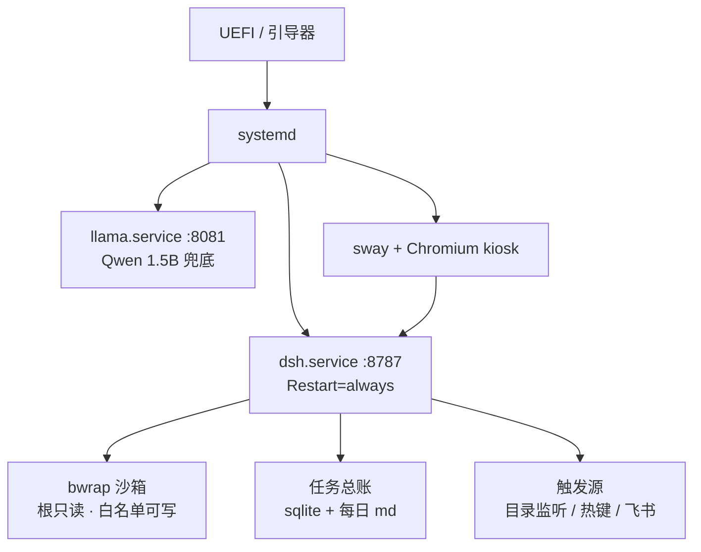

# DSH OS · 把 DeepSeek Harness 做成一台电脑的系统

> Linux 打底，DeepSeek Harness 当界面。开机不是打开一个 App，而是**进入这套系统**。

- **在线原型** → https://2405646728.github.io/dsh-os/ （直接用浏览器打开就是这个界面）
- **原型源码** → [index.html](./index.html)
- **方向与决策脑图** → [docs/DSH-系统化方向.md](./docs/DSH-系统化方向.md)
- **系统人设定稿** → [docs/DSH-系统-人设-v2.md](./docs/DSH-系统-人设-v2.md)

---

## 这是什么

一句话：**把现在"打开窗口才有 AI"的形态，改造成"电脑自己就是一个 AI 系统"。**

三件事同时成立才算数：

1. **界面即系统** —— 全屏 Chromium + 合成器，DSH 就是桌面，不是一个标签页
2. **关窗不断线** —— 宿主跑在 systemd 用户服务里，界面只是客户端
3. **电脑自己接活** —— 往目录里丢个文件、按个热键、飞书发一句，任务自己跑完并回推

---

## 现在到哪一步

| 阶段 | 状态 |
|---|---|
| 方向与 11 个板块定稿 | ✅ 完成 |
| 系统人设 v2 | ✅ 完成 |
| 可点原型（七页 + 假数据 + 动效） | ✅ 完成 |
| Windows 端装机助手 | 📋 已设计，排最后 |
| 虚拟机跑通 | ⬜ 未开始 |
| 裸机双系统 | ⬜ 未开始 |

> 原型里的数据全是假的，只有时间与农历是真的。这样做是为了接真 host 时，一眼能看出哪些位置需要换数据源。

---

## 架构（目标形态）



---

## 十一个板块的结论

| # | 板块 | 定了什么 |
|---|---|---|
| 1 | 平台与开机 | Ubuntu LTS；只用核显；先 GNOME 后 sway；自动登录 + 5 分钟锁屏；整块 Samsung 980 PRO 给 Linux；不加密；`/` 60G + `/home` 200G+；zram 代替 swap |
| 2 | 运行时 | `systemd --user` + linger（宿主先起）；固定端口 8787 + flock 单实例；崩了秒级重启、连续 5 次停手、重启续跑；journald + 文件双写；升级走双副本切换 |
| 3 | 界面 | 顶栏横跨整宽 + 左导航七页 + 右侧双卡 + 底部三卡 + Dock 八格；大时钟 + 农历；五颗能力胶囊；只做深色；宇宙鲸鱼背景 |
| 4 | 触发与任务 | 目录监听（模型自判）→ 热键悬浮派活框 → 飞书机器人；桌面通知 + 导航红点；所有来源进同一队列 |
| 5 | 权限与审计 | bwrap 沙箱 + sudoers 白名单 + cgroup 限额；单日花费上限 20 元；不可逆动作有人点确认、无人则挂起排队；审计 30 天 + 按月归档 |
| 6 | 数据与总账 | 明细进 sqlite，每天自动写一页 md 摘要进笔记；可导出 CSV / JSON |
| 7 | 镜像与交付 | 先只做 VM 镜像；安装器走 autoinstall + 定制 slideshow；不对外交付 |
| 8 | 风险与救回 | VM 分 8GB；装系统认准 Samsung 那块盘；Windows 快速启动必须关；保留 Windows 三个月 |
| 9 | 人设 | 名字首次运行填（默认「大肥鱼」）、可对话改名；语气直接冷静；全自主含联网；只记决定与产物；失败先自修限 2 次；边界三条 |
| 10 | 装机助手 | .NET 8 + WebView2；认机器 → 体检报告 → BIOS 四层指引 → 下官方镜像 → 写 U 盘；只认可移动盘 + 手输盘符确认 |
| 11 | 内置小模型 | Qwen 1.5B 烘进镜像；llama-server 暴露 OpenAI 兼容端点；配好 key 自动切云端，断网/超时自动降回本地；**不参与自动任务判断** |

---

## 验收标准

| 编号 | 标准 |
|---|---|
| E1 | 关掉界面，任务照跑 |
| E2 | 重启不丢，能续跑或明确标红可重试 |
| E3 | 一个总账：所有触发源进同一队列，结果回发起端 |
| E4 | 电脑自己接活，并留下可查痕迹 |
| E5 | 权限分级：无人值守不裸奔 |
| E6 | 重装后一条命令复原整套环境 |
| E7 | 新系统第一次开机，agent 就认识这台机器 |
| E8 | 装机助手把这台机器该改的设置一次讲清 |
| E9 | 没配 key 时系统也能对话与自检 |

---

## 目录结构

```
.
├── index.html                     # 可点原型（单文件，零依赖，Pages 首页）
├── bg.png                         # 原型背景
├── cover.png                      # 首页渲染图
└── docs
    ├── DSH-系统化方向.md           # 方向与决策脑图（全部板块结论）
    └── DSH-系统-人设-v2.md        # 系统人设定稿
```

## 本地打开原型

下载 `index.html` 与 `bg.png` 放在同一目录，双击 `index.html` 即可。不需要构建、不需要服务端。

原型里能点的：七页导航、`Ctrl+K` 搜索面板、任务行展开详情、知识库四个 tab、五颗胶囊、Dock 与快捷启动。URL 加 `#tasks` / `#knowledge` 可直达某页。

---

## 路线图

1. **虚拟机跑通** —— Hyper-V 起 Ubuntu，把宿主、固定端口、linger、续跑跑起来
2. **裸机双系统** —— 整块 Samsung 盘给 Linux，Windows 原封不动
3. **装机助手** —— 认机器、出体检报告、讲 BIOS、下镜像、写 U 盘
4. **固化镜像** —— 把跑通的产物烘成自己的 ISO，安装器换肤

## 本机实测前提

目标机：Acer Predator PHN16-71 · i9-13900HX 24C/32T · 16GB · RTX 4060 Laptop + Intel 核显 · 双 1TB NVMe。

三条已核实的施工前提：

- Samsung 那块盘的 500GB「未知分区」其实是 **APFS**（旧 macOS 残留），整盘可清
- Windows 快速启动开着，装双系统前**必须关**
- BitLocker 状态需要管理员权限确认
