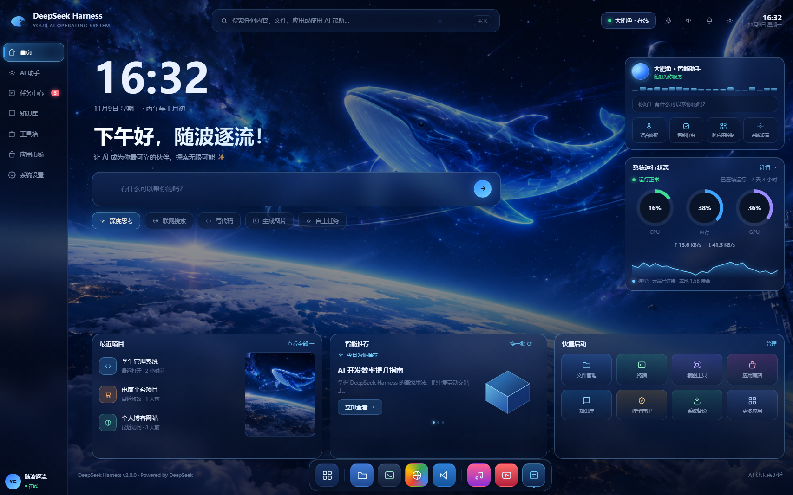
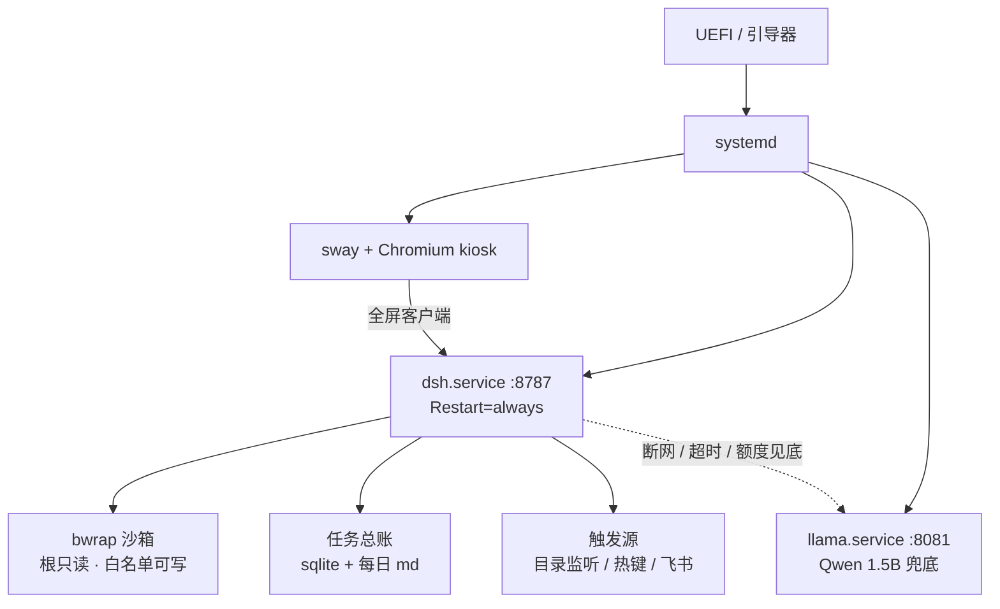

<div align="center">

# DSH OS

**把 DeepSeek Harness 做成一台电脑的系统**

Linux 打底 · 界面即系统 · 关窗不断线 · 电脑自己接活

[在线原型](https://2405646728.github.io/dsh-os/)　·　[决策脑图](docs/DSH-系统化方向.md)　·　[系统人设](docs/DSH-系统-人设-v2.md)

</div>



---

## 这是什么

现在用 AI 是这样的：打开一个窗口，问一句，关掉，它就消失了。

这个项目要把这件事反过来——**电脑开机就是这套系统，AI 是常驻的，不是被打开的**。

三条同时成立才算数：

| 判据 | 意思 |
|---|---|
| **界面即系统** | 全屏 Chromium + 合成器，DSH 是桌面本身，不是一个标签页 |
| **关窗不断线** | 宿主跑在 systemd 用户服务里，界面只是它的一个客户端 |
| **电脑自己接活** | 往目录丢文件、按个热键、飞书发一句，任务自己跑完并回推 |

第 2 条是关键：只要能关窗不断线，"AI 系统"和"AI 网页"就是两种东西。

---

## 现在到哪一步

| 阶段 | 状态 |
|---|---|
| 方向与 11 个板块定稿 | ✅ 完成 |
| 系统人设 v2 | ✅ 完成 |
| 可点原型（七页 / 假数据 / 动效） | ✅ 完成 |
| 虚拟机跑通 | ⬜ 未开始 |
| 裸机双系统 | ⬜ 未开始 |
| Windows 端装机助手 | 📋 已设计，排最后 |
| 固化自有镜像 | 📋 已设计，排最后 |

原型里的数据全是假的，**只有时间与农历是真的**（`Intl` 中国历法算的）。这样接真宿主时，一眼能看出哪些位置该换数据源。

---

## 架构



两条设计线：

- **宿主先起，界面后连**：`systemd --user` 加 linger，不等登录就把宿主拉起来。界面崩了重开不影响正在跑的任务。
- **本地兜底，不抢主活**：小模型只在没有 key 或断网时接手；目录监听、定时任务这类自动判断一律走云端，避免 1.5B 判错一次要回滚。

---

## 十一个板块的结论

<details open>
<summary><b>平台 · 开机 · 运行时</b></summary>

| # | 板块 | 定了什么 |
|---|---|---|
| 1 | 平台与开机 | Ubuntu LTS；只用核显；先 GNOME 调通再切 sway；自动登录 + 空闲 5 分钟锁屏；整块 Samsung 980 PRO 给 Linux；不加密；`/` 60G + `/home` 200G+；zram 代替 swap |
| 2 | 运行时 | `systemd --user` + linger；固定端口 8787 + flock 单实例；崩溃秒级重启、连续 5 次停手告警、重启后续跑；journald + 文件双写；升级走双副本切换 |
| 11 | 内置小模型 | Qwen 1.5B 烘进镜像；`llama-server` 暴露 OpenAI 兼容端点，端口 8081；配好 key 自动切云端 |

</details>

<details>
<summary><b>界面 · 触发 · 权限 · 数据</b></summary>

| # | 板块 | 定了什么 |
|---|---|---|
| 3 | 界面 | 顶栏横跨整宽 + 左导航七页 + 右侧双卡 + 底部三卡 + Dock 八格；大时钟 + 农历；五颗能力胶囊；只做深色；宇宙鲸鱼背景 |
| 4 | 触发与任务 | 目录监听（模型自判）→ 热键悬浮派活框 → 飞书机器人；桌面通知 + 导航红点；所有来源进同一队列 |
| 5 | 权限与审计 | bwrap + sudoers 白名单 + cgroup 限额；单日花费上限 ¥20；不可逆动作有人点确认、无人则挂起排队；审计 30 天 + 按月归档 |
| 6 | 数据与总账 | 明细进 sqlite，每天自动写一页 md 摘要进笔记；可导出 CSV / JSON |

</details>

<details>
<summary><b>人设 · 交付 · 风险</b></summary>

| # | 板块 | 定了什么 |
|---|---|---|
| 7 | 镜像与交付 | 先只做 VM 镜像；安装器走 autoinstall + 定制 slideshow；不对外交付 |
| 8 | 风险与救回 | VM 分 8GB；装系统认准 Samsung 那块盘；Windows 快速启动必须关；保留 Windows 三个月 |
| 9 | 人设 | 名字首次运行填（默认「大肥鱼」）、可对话改名；语气直接冷静；全自主含联网；只记决定与产物；失败先自修限 2 次；边界只有三条 |
| 10 | 装机助手 | .NET 8 + WebView2；认机器 → 体检报告 → BIOS 四层指引 → 下官方镜像 → 写 U 盘；只认可移动盘 + 手输盘符确认 |

</details>

---

## 验收标准

按"能不能用"排，不按功能多少排。

| 编号 | 标准 | 现在 |
|---|---|---|
| E1 | 关掉界面，任务照跑 | ⬜ |
| E2 | 重启不丢，能续跑或明确标红可重试 | ⬜ |
| E3 | 一个总账：所有触发源进同一队列，结果回发起端 | ⬜ |
| E4 | 电脑自己接活，并留下可查痕迹 | ⬜ |
| E5 | 权限分级：无人值守不裸奔 | ⬜ |
| E6 | 重装后一条命令复原整套环境 | ⬜ |
| E7 | 新系统第一次开机，agent 就认识这台机器 | ⬜ |
| E8 | 装机助手把这台机器该改的设置一次讲清 | ⬜ |
| E9 | 没配 key 时系统也能对话与自检 | ⬜ |

---

## 怎么跑

**在线看** → <https://2405646728.github.io/dsh-os/>

**本地看** → 下载 `index.html` 与 `bg.png` 放同一目录，双击 `index.html`。零依赖、零构建。

原型里能点的：

- 左侧七页导航全部可切（首页 / AI 助手 / 任务中心 / 知识库 / 工具箱 / 应用市场 / 系统设置）
- `Ctrl+K` 或点顶部搜索框 → 搜索面板
- 任务中心点任意一行 → 右侧详情抽屉
- 知识库四个 tab 切换；五颗胶囊可高亮
- URL 加 `#tasks` / `#knowledge` / `#market` 可直达某页

---

## 目录结构

```
.
├── index.html                     # 可点原型（单文件，Pages 首页）
├── bg.png                         # 原型背景
├── cover.png                      # 首页渲染图
└── docs
    ├── DSH-系统化方向.md           # 方向与决策脑图（逐板块结论）
    └── DSH-系统-人设-v2.md        # 系统人设定稿（可配置项 + 固定条款）
```

---

## 路线图

- [ ] **虚拟机跑通** —— Hyper-V 起 Ubuntu，把宿主、固定端口、linger、续跑跑起来
- [ ] **裸机双系统** —— 整块 Samsung 盘给 Linux，Windows 原封不动
- [ ] **装机助手** —— 认机器、出体检报告、讲 BIOS、下镜像、写 U 盘
- [ ] **固化镜像** —— 把跑通的产物烘成自己的 ISO，安装器换肤

---

## 目标机与已核实的施工前提

**Acer Predator PHN16-71** · i9-13900HX 24C/32T · 16GB · RTX 4060 Laptop + Intel 核显 · 双 1TB NVMe

三条已经查过、会直接影响施工的事：

1. Samsung 那块盘上的 500GB「未知分区」实际是 **APFS**（旧 macOS 残留），整盘可以清
2. Windows **快速启动是开着的**，装双系统前必须关，否则 NTFS 会被锁
3. **BitLocker 状态待确认**（要管理员权限才能读）

---

## 还没解决的问题

- **背景图**：现在用的是早期素材，与目标构图（鲸鱼偏右、右上有带环行星）不完全一致，缺一张纯净原图
- **站点域名**：GitHub 账号名是数字，地址是 `2405646728.github.io/dsh-os`；要不要换账号名或挂自定义域名
- **镜像来源**：先走官方 ISO + autoinstall，等配置不再天天动再固化自建镜像
